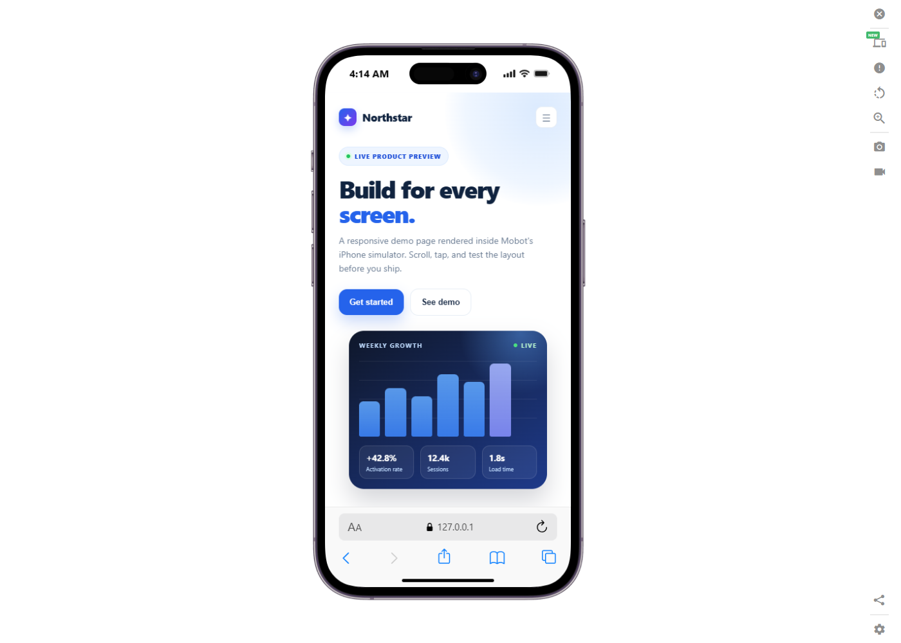
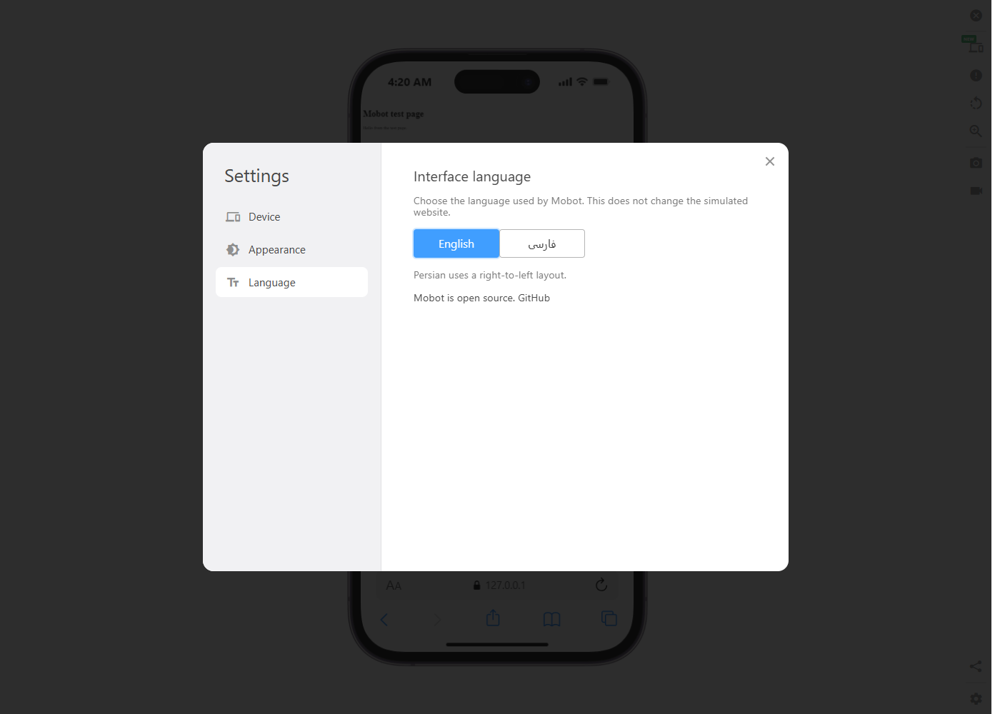
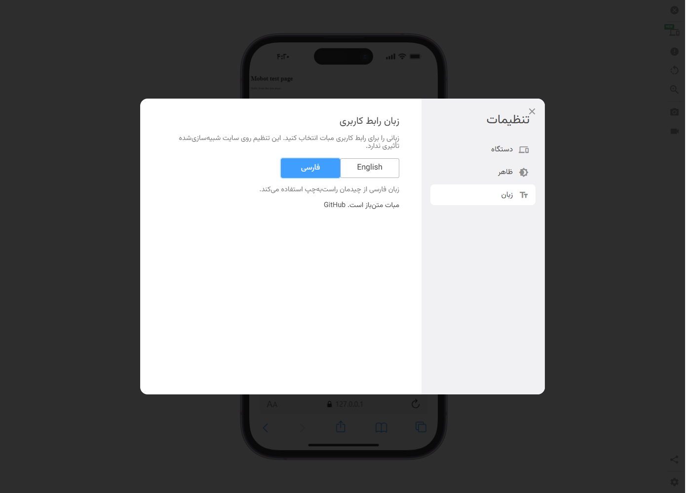

# Mobot

Mobot is an open-source Chrome extension for previewing and testing websites on
phones, tablets, laptops, TVs, kiosks, and other devices. It is a rebranded and
cleaned-up derivative of a previously published simulator extension.



## Features

- Device presets for iPhone, Android, iPad, tablets, laptops, TVs, kiosks, and
  more, with device frames and orientation controls.
- Custom devices with a viewport, user agent, and device pixel ratio.
- Side-by-side comparison of multiple devices with synchronized clicks,
  scrolling, and keyboard input.
- Screenshots in PNG and WebP formats, including device-only, site-only,
  full-page, and full-tab captures.
- Local WebM screen recording with optional microphone and camera capture.
- Zoom, touch scrolling, mobile cursor, keyboard simulation, PWA detection,
  URL bar, and presentation mode.
- English and Persian interfaces with an in-extension language switch.
  Persian uses a right-to-left layout; the simulated website stays LTR.
- Local-first settings. No account, subscription, trial, telemetry, cloud
  upload, or cloud video conversion.

## Install (unpacked)

Mobot is currently distributed from GitHub only. It is not on the Chrome Web
Store yet.

1. Clone or download this repository.
2. Open `chrome://extensions` in Chrome or a Chromium-based browser.
3. Enable **Developer mode**.
4. Choose **Load unpacked** and select the repository folder (the folder that
   contains `manifest.json`).
5. Pin Mobot, open a normal website, and click the Mobot toolbar button. You
   can also right-click the page and choose **Mobot → Open Mobot**.

To use Mobot on `file://` pages, open the extension's details in
`chrome://extensions` and enable **Allow access to file URLs**. The popup also
shows this instruction when it is opened on a local file.

To use keyboard shortcuts, assign them at `chrome://extensions/shortcuts`.
Mobot registers commands for recording and four screenshot slots; Chrome does
not assign defaults.

Some sites prevent their pages from being embedded in another page. Mobot
tries to make framing work, but a site's own security policy can still block
the simulation.

## Language

Open **Settings → Language** and choose **English** or **فارسی**. The choice is
stored locally and is also used by the popup. Persian switches the Mobot
interface to RTL; the simulated site remains LTR.

| English | Persian |
| --- | --- |
|  |  |

## Screenshots and recording

Screenshots and WebM recordings are generated in the browser and downloaded by
you. The old cloud upload, share-link, GIF, and MP4 conversion features are
disabled and their remote endpoints are not part of this build. Use the WebM
download for video.

## Privacy

Mobot does not collect analytics or send page content to a Mobot server. There
is no account system. Settings and the language preference are stored in
Chrome's extension storage. See [PRIVACY.md](PRIVACY.md) for the permission
list and details.

## Development

This repository contains the built extension. The original source tree, source
maps, and build pipeline were not available for this release, so the release is
a cleaned compiled bundle. Contributions should keep the existing file layout
and runtime behavior.

Requirements: Node.js 18 or newer.

```sh
npm run validate
```

The validation script checks the manifest, locale parity, JavaScript syntax,
required assets, and forbidden legacy strings. There are no npm dependencies
to install. For a runtime smoke test, load the folder as an unpacked extension
in Chromium, open a normal website, and verify the simulator, settings,
language switch, screenshot, and WebM recording flows.

## Repository layout

```text
_locales/         English and Persian messages
assets/           Device mockups, images, pictograms, fonts
css/              Simulator, popup, and RTL/font overrides
docs/screenshots  README screenshots
icons/            Extension icons
js/               Extension runtime and simulator bundle
offscreen/        Offscreen tab-capture page
pages/            Permission helper pages
workers/          Web workers
manifest.json     Manifest V3 definition
scripts/          Validation script
```

## Contributing

Bug reports and focused pull requests are welcome. Please read
[CONTRIBUTING.md](CONTRIBUTING.md) and follow the
[Code of Conduct](CODE_OF_CONDUCT.md). Do not add telemetry, account,
subscription, or cloud-upload features.

## Security

Please report vulnerabilities privately as described in [SECURITY.md](SECURITY.md).

## License

The Mobot-specific code and modifications are released under the MIT license.
See [LICENSE](LICENSE) and [NOTICE](NOTICE) for the upstream-bundle and
derivative-work notice. Third-party components and their licenses are listed in
[THIRD-PARTY-LICENSES.md](THIRD-PARTY-LICENSES.md).
